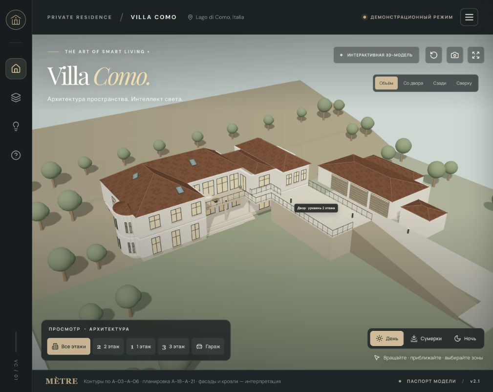
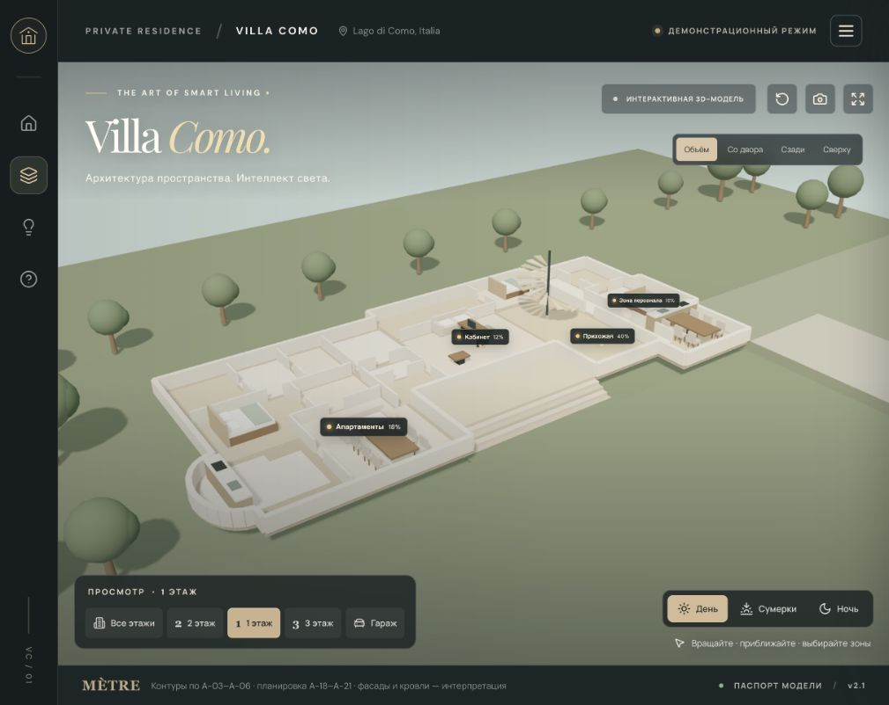
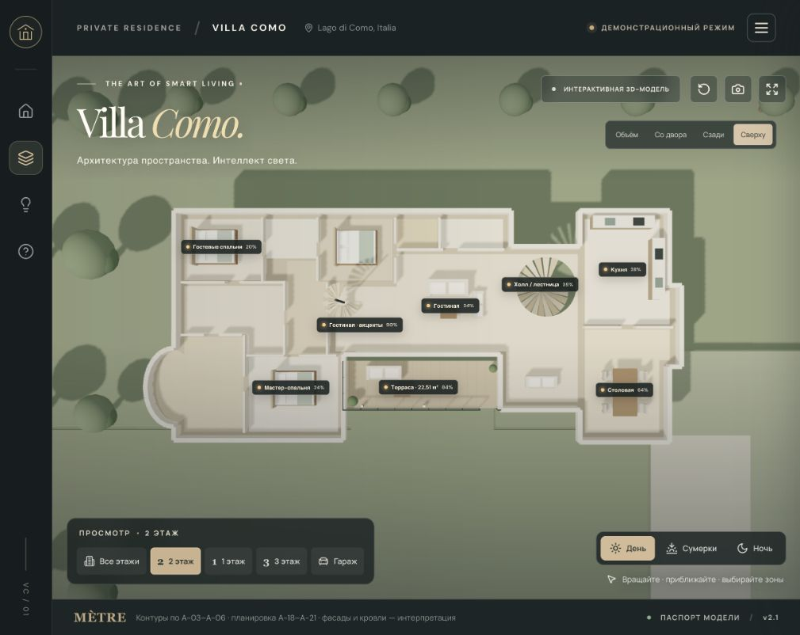

# Проверка Villa Como по проекту MÈTRE

Проверка: 7 ноября 2026. Исходник: 94-страничный файл «!!!_Вилла_Комо_09_02_26_общий_файл_1.pdf», предоставленный владельцем. Полный PDF в репозиторий не добавлен.

## Вывод

Предыдущая версия передавала общее назначение крыльев и названия зон, но её внешнюю геометрию нельзя было считать достоверной реконструкцией. Особенно отличались гараж, терраса, мансарда и внутренние помещения. Новая версия использует оцифрованные контуры обмерных/мебельных планов. Посадка гаража, двор на уровне 2 этажа, примыкание задней стороны 1 этажа к горе и нижняя терраска кабинета с четырьмя широкими ступенями — уточнения владельца, не сведения из генплана.

Общий «процент совпадения дома» не приводится: в представленном комплекте нет наружных фасадов, разрезов здания, плана наружной кровли и генплана с совместной посадкой дома и гаража. Планировка и внешний облик имеют разный уровень подтверждения.

## Что проверено и исправлено

| Элемент | Предыдущая модель | Проверка источника / исправление |
| --- | --- | --- |
| Общий контур | Набор пересекающихся прямоугольных объёмов | Отдельные непрерывные контуры 1 и 2 этажей по A-04/A-05/A-19/A-20: полукруглый выступ слева, ступенчатый правый фасад, утопленный двор, различие заднего контура этажей |
| Планировка | 4 / 5 / 2 условных прямоугольных комнаты | 19 / 13 / 5 помещений по A-19/A-20/A-21; на 2 этаже 12 внутренних помещений и терраса |
| Терраса | Поверхность 10,1 × 4,0 = 40,40 м², хотя UI показывал 22,51 м² | Доступная поверхность 22,51 м² по ведомости A-20, уменьшение примерно на 44%; между крыльями на уровне 2 этажа |
| Высота 2 этажа | Разница уровней 3,01 м | Разница +2,930 м по A-05; все элементы используют общий набор высот |
| Мансарда | Два высоких прямоугольных объёма, неполный контур | Г-образный план A-06/A-21, короткие стены в разрезанном виде и кровля над мансардой; спальня имеет локальное повышение 0,21 м |
| Гараж | Слева перед домом, длинной стороной параллельно дому | Справа при взгляде из двора на дом, отдельное одноэтажное здание, поворот на 90°, пол совпадает с полом 1 этажа — по уточнению владельца |
| Контур гаража | Прямоугольник с произвольной пристройкой | A-03/A-18: основной объём, выступ с лабораторией/складами, боковые служебные помещения, отдельный винный погреб |
| Ворота | Три условных одинаковых полотна | Проёмы 3,72 / 3,72 / 3,60 м по A-03, направлены во двор; отметка пола едина с 1 этажом |
| Связь верхней террасы с двором | Ошибочно добавленный наружный марш | Марш полностью удалён: двор и верхняя терраса находятся на уровне 2 этажа. Ровный переход показан схематично, без заполнения пространства нижних ступеней |
| Вход в кабинет | Нижняя терраска не была выделена | На уровне 1 этажа добавлена терраска и ровно 4 ступени на всю её ширину. Количество и ширина ступеней относительно терраски подтверждены владельцем; абсолютные габариты и высота подступенка условны |
| Рельеф | Плоская поверхность на уровне 1 этажа | Сзади грунт примыкает к дому на уровне 2 этажа, закрывая заднюю сторону 1 этажа; выше поднимается склон. Спереди сохраняется нижний сад, сбоку — верхний двор и условный съезд к гаражу |
| Стены и окна | Стекло накладывалось на сплошные блоки; часть задних окон смотрела внутрь | Стены разбиты вокруг проёмов; нормали окон направлены наружу по каждому сегменту фасада |
| Кровля | Несколько пересекающихся двускатных тел, горизонтальные рейки проходили через скаты | Основная Г-образная кровля собрана из общих вершин коньков/ендовы; отдельные объёмы пристроек согласованы по карнизам, черепица лежит в плоскости скатов |
| Лестницы внутри | Условные спирали и сплошные перекрытия | Общие центры лестниц, отверстия в перекрытиях/отделке; межэтажные марши не закрыты поверхностью пола |
| Гостевые группы света | Группы 5/6 | На A-36 спальни имеют группы 5 и 7; 6 относится к санузлу. Исправлено |
| Гостиная / лестницы | Произвольное деление 8.1–8.4 и 8.5–8.9; холл ошибочно относился к 7 | Основное освещение 8.1–8.6, акценты 8.7–8.9; холл/лестницы 1.1–1.2 и 8.1–8.2. Последняя группа визуально укрупнена, не представляет отдельный физический канал |
| Терраса / двор | Б.1/Б.2 объединены; датчики ворот выдавались за двор | Б.1 относится к террасе; Б.2 — другой наружный фасад. Двор остаётся отдельной демонстрационной группой; датчик открытия ворот не равен наружной группе света |

## Масштаб и площади

Координаты перенесены вручную с рендера планов шириной 1800 px. Калибровка: размер 10 080 мм на A-05 занимает около 539 px, то есть 53,472 px/м. Координаты хранятся в метрах в `src/data/architecture.js`. Мансарда совмещена с 2 этажом по малой винтовой лестнице, а не по краю листа.

Контроль суммы площадей оцифрованных зон, без учёта высоты под скатами и отверстий лестниц:

| Уровень | Ведомость | Площадь обведённых внутренних зон | Разница |
| --- | ---: | ---: | ---: |
| 1 этаж | 247,85 м² | около 249,63 м² | около +0,72% |
| 2 этаж, без террасы | 239,73 м² | около 241,25 м² | около +0,63% |
| Терраса | 22,51 м² | 22,51 м² | 0% |

Это контроль пропорций оцифровки, а не доказательство точности каждого размера. Площади наружных контуров включают толщины стен и не сравниваются напрямую с чистыми площадями ведомостей. Для мансарды такое сравнение особенно некорректно: A-06 показывает высоты под скатами 0,64–2,77 м, а чистая площадь исключает часть низких зон. Сумма строк A-21 равна 66,78 м², напечатанный итог — 66,79 м²; в интерфейсе сохранён итог источника.

Система координат сцены: пол 1 этажа/гаража — Y=0,18 м, пол 2 этажа и верхний двор — Y=3,11 м; перепад +2,930 м отсчитывается от 1 этажа. Нижний сад — Y=−0,46 м, то есть на 4 условных подступенка по 0,16 м ниже терраски кабинета. Эти абсолютные Y — внутренние координаты демо, не геодезические отметки. A-06 содержит локальные отметки +3,000 / +3,210 без общего высотного разреза в этом комплекте. Межэтажное расстояние к мансарде принято 3,00 м с локальной ступенью 0,21 м; абсолютную высотную привязку нужно подтвердить разрезом.

## Что остаётся приближением

- Схема и угол наружных скатов, коньки, карнизы, материалы фасадов/кровли, декоративные детали и точная геометрия оконных переплётов.
- Точное расстояние до гаража: в сцене принят зазор около 5,2 м; единственное подтверждение его посадки — сторона/поворот/этажность/направление въезда, сообщённые владельцем.
- Точные размеры нижней терраски кабинета и её ступеней (принято 4 × 0,16 м с проступью 0,30 м). Длинной лестницы с верхней террасы нет. Ровный переход, ограждения и опоры до верхнего двора — схема, не подтверждённая наружным чертежом.
- Топография и подпорные стены: подтверждены только примыкание горы сзади и уровень двора. Уклон, контуры двора и съезд к более низкому гаражу введены для согласования уровней в демонстрации, не являются проектом проезда.
- Упрощённая мебель, положение части дверных разрывов внутренних перегородок и небольшие расхождения из-за ручной обводки. Визуальные стены разрезанного плана имеют сниженную высоту для обзора.
- Мебельные зоны и 16 управляющих групп не являются полным поштучным перечнем светильников. Группы апартаментов, персонала, гостевых комнат и лестниц укрупнены для демонстрации.
- Озеленение, мощение, уклон/границы участка. A-38 упомянут в ведомости, но между A-37 и A-40 в предоставленном PDF отсутствует; план освещения участка в этот файл не включён.

## Проверка результата

`pnpm run check:geometry` проверяет самопересечения контуров, выход комнат за перекрытия, взаимные наложения комнат, соответствие проёмов стенам, контроль площадей первых двух этажей, отметки, сторону/поворот/нормали ворот гаража, площадь террасы, 4 широкие нижние ступени, отсутствие пересечений верхнего перехода с домом, высоту двора/склона/съезда, положение световых маркеров и диапазоны сценариев. Это набор геометрических инвариантов, не полный строительный clash detection.

`pnpm run build` собирает production-версию. Для визуальной проверки доступны ракурсы «Объём», «Со двора», «Сзади», «Сверху» и отдельные уровни.

В браузере проверены общий вид и задняя сторона, три этажа сверху, гараж, вращение/зум и мобильная панель со сменой сценариев. После уточнения рельефа повторно проверены фасад/задняя сторона, планы 1–2 этажей без перекрывающего грунта, Master off (0/16), ручная яркость одной группы (1/16) и возврат к сцене. Ошибок/предупреждений в консоли не обнаружено. Паспорт описывает новые уточнения и условность топографии; на узком экране длинный заголовок переносится, текст прокручивается.

Вид со двора после уточнения рельефа: гараж справа ниже верхнего двора, нижняя терраска с четырьмя ступенями; длинного наружного марша нет:

Нижняя терраска и четыре широкие ступени, вид 1 этажа без верхних объёмов:

Контрольный вид второго этажа:

